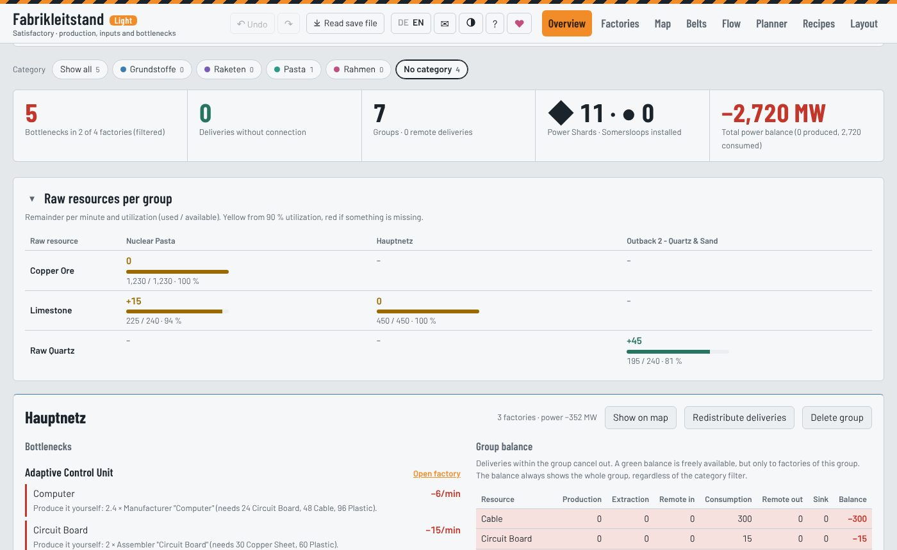
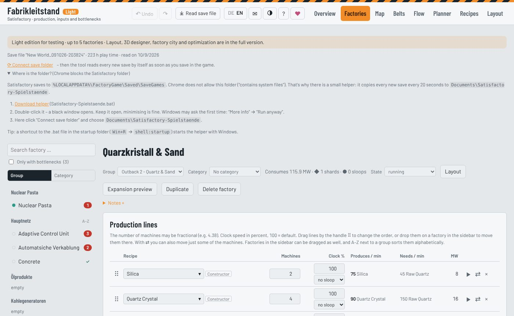
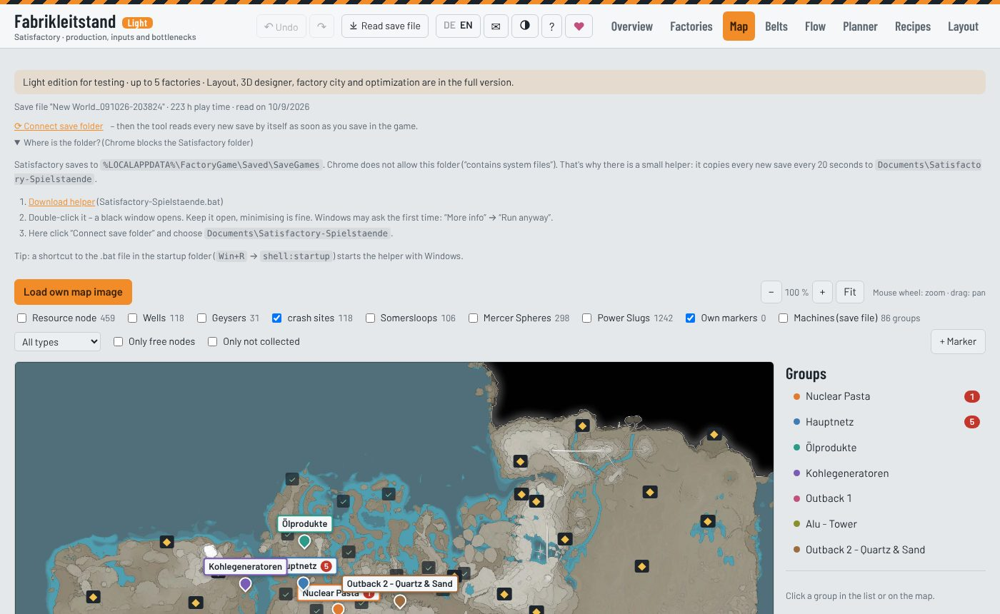
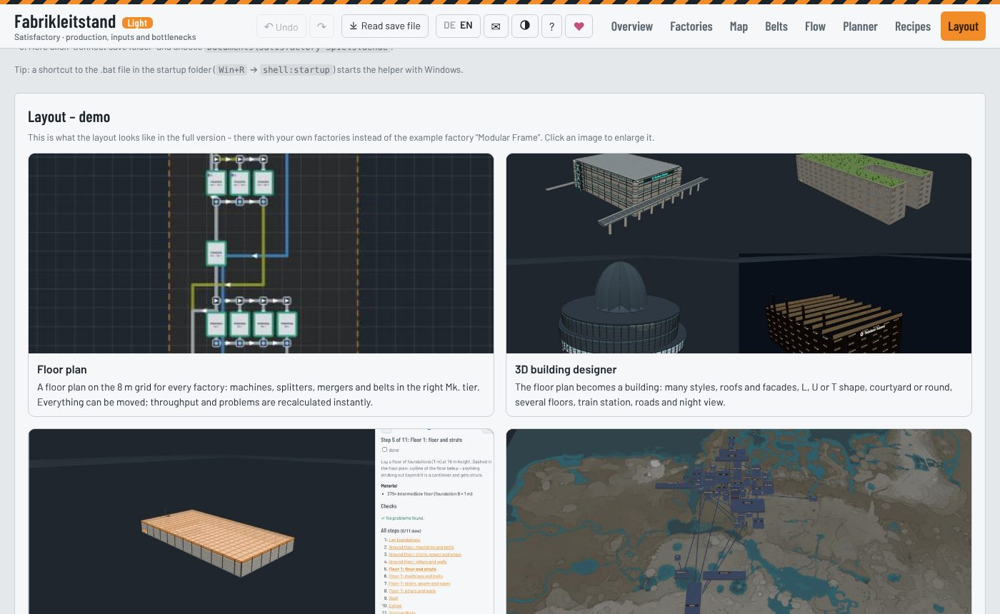

# Satisfactory Ultimate Tool – Fabrikleitstand (Light)

A browser-based control center for **Satisfactory**. Read your save file, plan factories and supply chains, and find bottlenecks and stalled machines before they slow you down in the game.

**Single HTML file · runs offline · no install · your save file never leaves your computer · English / Deutsch**

> This repository contains the **Light edition** for testing. It is limited to 5 factories. The layout designer, 3D buildings, build guide, factory city and the optimizers are only in the full version. The light edition shows a demo of them.

## Getting started

1. Download `fabrikleitstand_light.html`.
2. Open it in a current browser (Chrome, Edge or Firefox).
3. Click **Read save file** and choose your `.sav`. The game stores saves in  
   `%LOCALAPPDATA%\FactoryGame\Saved\SaveGames`.
4. Follow the guided tour (**?** at the top right).

Everything is stored locally in your browser. You can also save it to a file or export it as JSON.

## Features in the Light edition

| | |
|---|---|
| **Overview** | Bottlenecks, missing deliveries, power balance, raw resources per group, comparison with your save file |
| **Factories** | Production lines with recipe, machines, clock speed, Somersloops. Deliveries between factories, live balance (up to 5 factories) |
| **Map** | Resource nodes, wells, Somersloops, hard drives, Mercer spheres and your real machines from the save |
| **Belts** | Every belt and pipe from the save, too-slow belts highlighted, stall detector explaining *why* a machine stands still |
| **Flow** | Material flow between factories as a diagram |
| **Planner** | Target calculator down to raw resources, expansion preview, space elevator tracker, hard drive advisor |
| **Auto reload** | Connect your save folder once and the tool reads every new save automatically |

## Full version (not included here)

- Automatic floor plans on the 8 m grid with splitters, mergers and belts
- 3D building designer: many styles, roofs, facades, L/U/T/round floor plans, train stations, roads, night view
- Step-by-step build guide with material lists
- Factory city: all buildings on the real map
- Hard drive order and Somersloop / power shard distribution

## Feedback

Use the **✉ Feedback** button in the tool or open an [issue](../../issues).  
If you like the tool, you can support it via the **♥** button or [PayPal](https://www.paypal.com/paypalme/jerome1231).

---

### Deutsch

Leitzentrale für Satisfactory im Browser: Spielstand einlesen, Fabriken und Lieferketten planen, Engpässe und Stillstände finden. Eine einzige HTML-Datei. Sie läuft offline, und dein Spielstand verlässt nie deinen Rechner. Die Sprache lässt sich oben rechts umschalten (DE/EN).

Diese **Light-Edition** zum Testen erlaubt bis zu 5 Fabriken. Bauplan, 3D-Gebäude, Bauanleitung, Fabrikstadt und die Optimierung gibt es nur in der Vollversion; in der Light-Edition zeigt eine Demo, was sie können.

*Satisfactory is a trademark of Coffee Stain Studios. This is an unofficial fan project.*
